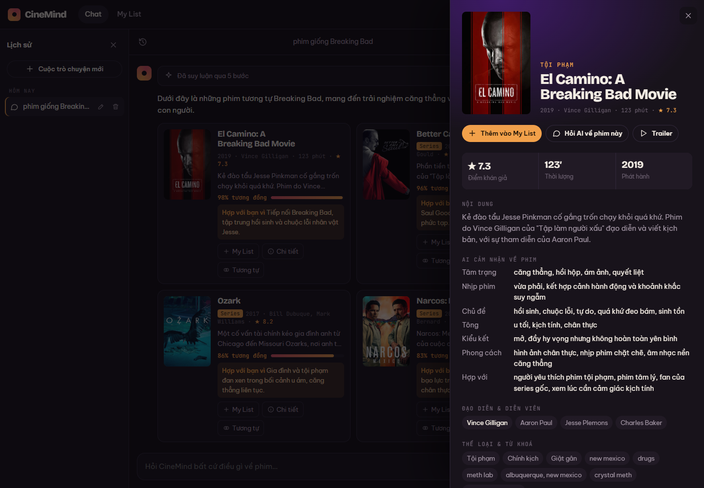
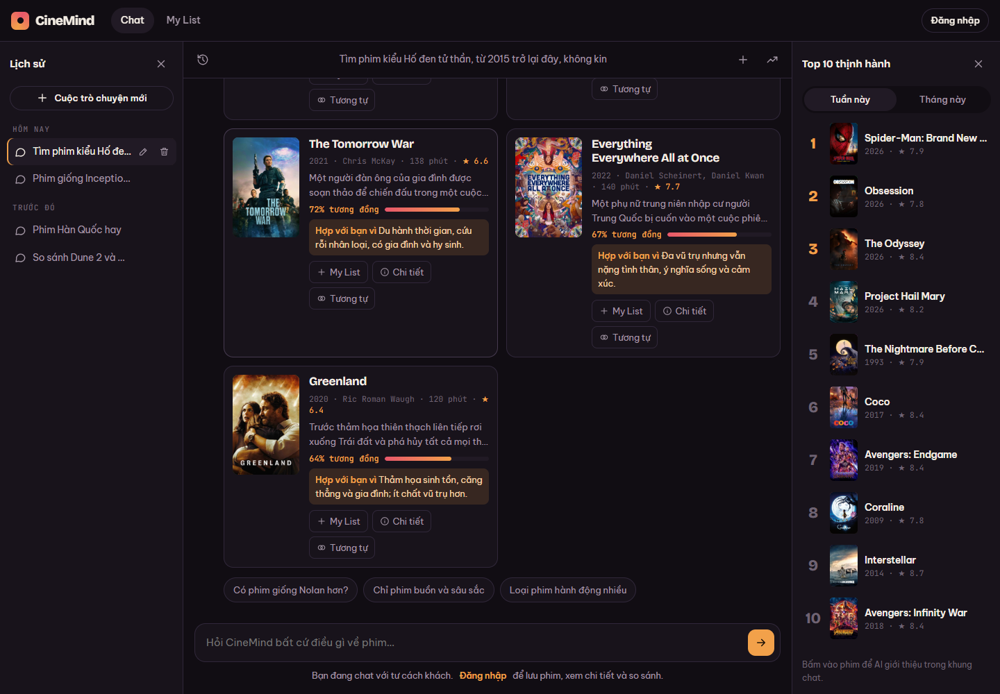
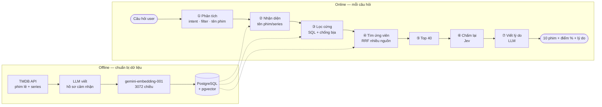

<div align="center">

# 🎬 CineMind

**Trợ lý tìm phim bằng tiếng Việt — hỏi như nói chuyện, nhận gợi ý kèm lý do.**

*"phim giống Hố đen tử thần, từ 2015, không kinh dị"* · *"phim bộ Hàn tâm lý hồi hộp"* · *"phim làm mình khóc hết nước mắt"*


**11.025 phim & series được gợi ý** · **31.710 tên nhận diện được** · **95% gợi ý được chấm "hợp"** trên 100 câu hỏi thật


</div>

---

## Mục lục
- [Điểm nổi bật](#-điểm-nổi-bật)
- [Cách hoạt động](#-cách-hoạt-động)
- [Kết quả đánh giá](#-kết-quả-đánh-giá)
- [Bắt đầu nhanh](#-bắt-đầu-nhanh)
- [Cấu trúc dự án](#-cấu-trúc-dự-án)
- [API](#-api)
- [Công nghệ](#-công-nghệ)
- [Tài liệu](#-tài-liệu)
- [Giới hạn & hướng phát triển](#-giới-hạn--hướng-phát-triển)

---

## ✨ Điểm nổi bật

| | |
|---|---|
| 🗣️ **Hiểu tiếng Việt tự nhiên** | Câu mơ hồ, tiếng lóng ("đỉnh nóc kịch trần", "hàn xẻng"), gõ không dấu, gõ sai ("intersteller") |
| 🎯 **Nhận diện tên phim / series** | Tên gốc, tên Việt, tên dài — *Hố đen tử thần* → Interstellar · *Trò chơi con mực* → Squid Game · *Bóng ma Anh Quốc* → Peaky Blinders |
| 🧱 **Lọc chính xác, không bịa** | Năm, quốc gia, thể loại, thời lượng, độ tuổi, đạo diễn/diễn viên, phim lẻ/series, loại trừ ("không kinh dị"). 4 lớp kiểm tra bằng code → **0 phim vi phạm điều kiện** |
| 🧠 **Hiểu "cảm giác" của phim** | Mỗi phim có *hồ sơ cảm nhận* do LLM viết: tâm trạng, nhịp, chủ đề, kiểu kết, hợp với ai |
| 🏷️ **Chip lọc tương tác** | Thấy rõ đang lọc gì, bấm ✕ để gỡ, "+ Thêm" điều kiện, filter giữ qua các lượt chat |
| ⚡ **Trả lời dần (stream)** | Thẻ phim hiện sau ~6 s, lý do điền sau — không phải ngồi chờ |
| 🔍 **Tương tự & so sánh** | Phim tương tự, so sánh 2–3 phim với % giống nhau theo *Nội dung · Chủ đề · Đội ngũ* |
| 🙋 **Biết nói "không biết"** | Không có phim trong kho → nói thật và hỏi lại, không đoán bừa theo nghĩa đen của tên |

<table>
<tr>
<td width="50%"><br><sub><b>Chi tiết phim</b> — hồ sơ cảm nhận do AI viết + phim tương tự</sub></td>
<td width="50%"><br><sub><b>Gỡ chip lọc</b> — chạy lại ngay, không phải gõ lại câu hỏi</sub></td>
</tr>
</table>

---

## 🧭 Cách hoạt động



| Bước | Làm gì | Công cụ |
|---|---|---|
| ① Phân tích | Câu hỏi → JSON có cấu trúc: ý định, điều kiện lọc (kèm trích dẫn nguyên văn làm bằng chứng), mong muốn mơ hồ, tên phim nhắc tới | gpt-4.1-mini |
| ② Nhận diện tên | Khớp mờ trên tên gốc / tên Việt / tên khác, theo từ, ưu tiên phim phổ biến | pg_trgm |
| ③ Lọc cứng | Chỉ lọc những gì user nói rõ; ít kết quả thì tự nới và báo user | SQL |
| ④ Tìm ứng viên | Gộp xếp hạng từ nhiều nguồn bằng **Reciprocal Rank Fusion**: giống câu hỏi · giống phim tham chiếu (×2) · trùng đạo diễn/diễn viên | pgvector |
| ⑥ Chấm lại | Chấm 40 ứng viên song song: khớp nội dung, khớp chủ đề, có vi phạm điều user không muốn | [Jev](https://docs.typesafe.ai) |
| ⑦ Viết | Lời mở đầu + lý do từng phim + câu gợi ý hỏi tiếp; chỉ được nhắc phim có trong danh sách | gpt-4.1-mini |

> Mọi phim trả về đều có ID trong cơ sở dữ liệu — LLM **không thể bịa ra phim**. Điểm "Đội ngũ" tính bằng code từ dữ liệu cast/crew thật.

---

## 📊 Kết quả đánh giá

**100 câu hỏi viết theo cách người thật xin gợi ý phim** (dựa trên nghiên cứu về r/ifyoulikeblank, Reddit-Movie), chấm từng phim trong top 10 bằng một LLM giám khảo khác model của engine:

| Nhóm câu hỏi | Số câu | Phim hợp | Rất hợp |
|---|---|---|---|
| Giống phim X | 19 | 93% | 48% |
| Tâm trạng / cảm xúc | 14 | 99% | 77% |
| Mô tả cốt truyện / chủ đề | 10 | 99% | 77% |
| Điều kiện rõ (năm, quốc gia, thể loại…) | 12 | 92% | 70% |
| Hoàn cảnh xem (người yêu, cả nhà…) | 7 | 97% | 73% |
| Loại trừ ("không máu me", "không phải Disney") | 6 | 97% | 78% |
| Series | 8 | 92% | 52% |
| Theo đạo diễn / diễn viên | 4 | 98% | 92% |
| Cách gõ Việt (không dấu, sai, tiếng lóng) | 8 | 95% | 52% |
| Hỏi tiếp lượt 2 | 4 | 95% | 70% |
| Pha trộn nhiều phim | 5 | 84% | 36% |
| **Tổng** | **100** | **95%** | **65%** |

**100% câu hỏi có ít nhất 1 phim "rất hợp" trong top 3** · thời gian trả lời trung vị 10,7 s (thẻ phim hiện sau ~6 s) · ~2 cent / câu hỏi.

<details>
<summary><b>Các lựa chọn khác đã được đo và loại</b></summary>

| Đã thử | Kết quả | Chi tiết |
|---|---|---|
| Embedding: bge-m3 · text-embedding-3-large · **gemini-embedding-001** | gemini thắng mọi chỉ số (Recall@100 0,904 vs 0,836 vs 0,665) | [steps/02](docs/steps/02-embedding.md) |
| Đa dạng hoá bằng MMR trước khi chấm | bỏ — làm mất phim đúng | [steps/08](docs/steps/08-eval100.md) |
| Rerank bằng qwen3-rerank | đắt gấp 4–5 lần Jev, không tốt hơn | [steps/08](docs/steps/08-eval100.md) |
| deepseek-v4-flash cho bước phân tích | chậm gấp 2–3, đắt gấp 15, chỉ chính xác hơn rất ít | [steps/07](docs/steps/07-series-jev-frontend.md) |
| Cốt truyện Wikipedia thay tóm tắt khi embed | +1–2%, chưa đáng chi phí | — |

</details>

---

## 🚀 Bắt đầu nhanh

**Cần:** Docker Desktop · Python 3.12 · Node 18+ · key TMDB (miễn phí) · key LLM tương thích OpenAI (có hỗ trợ `/v1/systemone` nếu dùng Jev)

```bash
git clone https://github.com/usermangcut-ai/cinemind.git && cd cinemind

# 1. Cơ sở dữ liệu
cd backend
cp .env.example .env                 # điền TMDB_READ_TOKEN, LLM_API_KEY
docker compose up -d                 # PostgreSQL 16 + pgvector

# 2. Backend
python -m venv .venv
.venv/Scripts/pip install -r requirements.txt     # Linux/macOS: .venv/bin/pip
.venv/Scripts/python -m uvicorn app.main:app --port 8000

# 3. Frontend (terminal khác)
cd frontend && npm install && npm run dev        # → http://localhost:5173/chat
```

**Nạp dữ liệu lần đầu** — trong `backend/`, dùng Python của `.venv` (chi tiết: [`backend/README.md`](backend/README.md)):
```bash
python etl/fetch_tmdb.py && python etl/load_db.py         # phim lẻ (~15k)
python etl/fetch_tmdb_tv.py && python etl/load_tv.py      # series (~16k)
python etl/profile.py --kind movie --min-year 1975 --limit 5000   # hồ sơ cảm nhận (tốn tiền LLM)
python -m etl.embed && python -m etl.embed --tv           # vector
python etl/trending.py                                     # Top 10 tuần/tháng
```
> 🇻🇳 Một số nhà mạng tại Việt Nam chặn `api.themoviedb.org` → bật **Cloudflare WARP** (hoặc DNS 1.1.1.1) khi chạy các lệnh `fetch_*` / `trending`.

---

## 📁 Cấu trúc dự án

```
cinemind/
├── frontend/                 React 18 + Vite
│   └── src/
│       ├── lib/ai.js         gọi engine (stream, tương tự, so sánh) — API tắt thì dùng mock
│       ├── store.jsx         state: chat, filter theo cuộc chat, My List
│       ├── components/       thẻ phim, chip lọc, bảng so sánh, drawer chi tiết
│       └── pages/            Landing · Chat · My List · Login
├── backend/                  Python 3.12 + FastAPI
│   ├── app/
│   │   ├── main.py           REST + stream (NDJSON)
│   │   ├── llm.py            client LLM, tự xoay model dự phòng khi provider lỗi
│   │   ├── embedder.py       embedding + đoạn văn đại diện phim
│   │   └── engine/           pipeline · parse ① · titles ② · filters ③ · retrieve ④ · rank ⑥⑦ · similar
│   ├── etl/                  kéo TMDB, nạp DB, viết hồ sơ, embed, trending
│   ├── eval/                 bộ 40 câu có đáp án + 100 câu kiểu người dùng thật, các script đo
│   ├── db/schema.sql
│   └── docker-compose.yml
└── docs/
    ├── engine-design.md      thiết kế chi tiết + hợp đồng API
    ├── glossary.md           giải thích thuật ngữ & từng trường dữ liệu
    ├── PROGRESS.md           trạng thái & việc còn lại
    └── steps/00–08           nhật ký từng bước, có input/output thật làm bằng chứng
```

---

## 🔌 API

| Endpoint | Mô tả |
|---|---|
| `POST /api/ask` | Trả lời 1 lần: `{text, filters?}` · `{type: similar \| compare \| about \| refilter, …}` |
| `POST /api/ask/stream` | Như trên nhưng stream NDJSON: `steps` → `preview` (10 phim + điểm) → `final` |
| `GET /api/similar?id=&n=` | Phim tương tự (không gọi LLM) |
| `GET /api/pair?a=&b=` | % tương đồng giữa 2 phim |
| `GET /api/movies?ids=` | Thông tin phim (poster, hồ sơ cảm nhận…) |
| `GET /api/trending` | Top 10 tuần / tháng |
| `GET /api/health` | Tình trạng kho dữ liệu & cấu hình |

<details>
<summary>Ví dụ kết quả <code>POST /api/ask</code></summary>

```json
{
  "steps": ["Phân tích câu hỏi", "Nhận diện: Kẻ trộm giấc mơ → Inception (2010)",
            "Lọc: Dưới 120 phút. Không phim Mỹ (còn 344 phim)", "…", "Chấm lại & viết giải thích (Jev)"],
  "text": "Mình ưu tiên các phim dưới 2 tiếng, có chất xoắn não gần Inception, và không phải phim Mỹ.",
  "movies": [
    { "id": 4977, "reason": "Giống nhất về giấc mơ – thực tại, nhịp dồn dập.",
      "sim": { "score": 87, "parts": { "Nội dung": 0.96, "Chủ đề": 0.98, "Đội ngũ": 0.0 } } }
  ],
  "filters": [
    { "field": "runtime_max", "value": 120, "label": "Dưới 120 phút", "evidence": "dưới 2 tiếng" },
    { "field": "exclude_countries", "value": ["US"], "label": "Không phim Mỹ", "evidence": "không phải phim Mỹ" }
  ],
  "chips": ["Phim xoắn não hơn nữa", "Chỉ phim châu Á thôi"]
}
```
</details>

---

## 🛠️ Công nghệ

| Tầng | Lựa chọn |
|---|---|
| Dữ liệu | TMDB API (phim lẻ + series, tên & tóm tắt tiếng Việt) · IMDb ratings |
| Cơ sở dữ liệu | PostgreSQL 16 · pgvector (HNSW, `halfvec(3072)`) · pg_trgm · unaccent |
| Embedding | gemini-embedding-001 |
| LLM | gpt-4.1-mini (phân tích, viết hồ sơ, viết lý do) |
| Rerank | Jev (TypeSafe AI) — chấm điểm có xác suất |
| Backend | FastAPI · psycopg 3 · httpx |
| Frontend | React 18 · React Router · Vite |

---

## 📚 Tài liệu

| | |
|---|---|
| [Thiết kế engine](docs/engine-design.md) | Từng bước, công thức điểm, hợp đồng API |
| [Thuật ngữ](docs/glossary.md) | RRF, embedding, hồ sơ phim, từng trường dữ liệu — giải thích dễ hiểu |
| [Nhật ký](docs/steps) | 9 bước xây dựng, mỗi bước có số liệu đo thật |
| [Backend](backend/README.md) · [Frontend](frontend/README.md) | Cài đặt, ETL, cấu hình model |

---

## 🧩 Giới hạn & hướng phát triển

- [ ] Kiểu câu **"giống X nhưng …"** và pha trộn nhiều phim còn yếu nhất (36% rất hợp)
- [ ] Series châu Á (Trung, Hàn, Thái) đã nhận diện được nhưng phần lớn chưa có hồ sơ → ít được gợi ý
- [ ] Đăng nhập thật + lưu My List / lịch sử trên server (hiện lưu ở trình duyệt)
- [ ] Cache câu hỏi lặp lại · xuất sẵn file dữ liệu để khỏi phải tự nạp từ đầu
- [ ] Tự cập nhật phim mới và trending hằng ngày

---

<div align="center">
<sub>
Dữ liệu phim từ <a href="https://www.themoviedb.org">TMDB</a> — <i>This product uses the TMDB API but is not endorsed or certified by TMDB.</i>
Điểm IMDb từ <a href="https://developer.imdb.com/non-commercial-datasets/">IMDb Non-Commercial Datasets</a>.
</sub>
</div>
