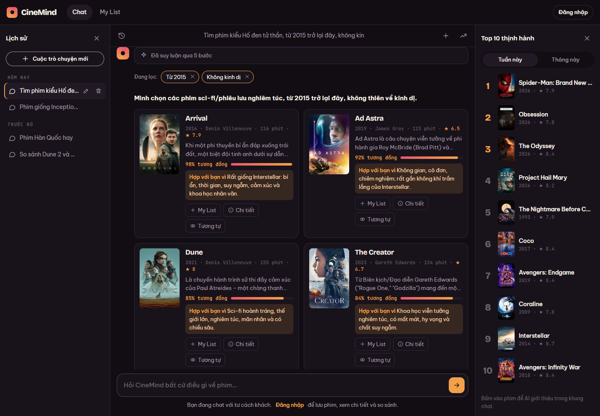

# Bước 6 — API + nối frontend · kết quả cuối

> Trạng thái: ✅ Frontend gọi engine thật; không gọi được API thì tự quay về mock (demo vẫn chạy).
> Backend: `backend/app/main.py` · Frontend: `src/lib/ai.js`, `src/data/movies.js`, `src/store.jsx`, `src/components/movies.jsx`, `src/pages/Chat.jsx`, `src/styles.css`.

## 1. Chạy
```bash
cd backend
docker compose up -d                                         # DB
.venv/Scripts/python -m uvicorn app.main:app --port 8000      # API
cd .. && npm run dev                                          # frontend http://localhost:5173/chat
```
Đổi địa chỉ API: biến `VITE_API_URL` (mặc định `http://localhost:8000`).

## 2. API
| Endpoint | Làm gì |
|---|---|
| `POST /api/ask` | input/output đúng hợp đồng `ask()` (`engine-design.md` §5) + `catalog` (dữ liệu phim để hiển thị) |
| `GET /api/movies?ids=1,2` | dữ liệu phim theo shape của `src/data/movies.js` |
| `GET /api/trending` | Top 10 tuần/tháng (bảng `trending`, cập nhật bằng `etl/trending.py`) |
| `GET /api/health` | `{"movies":15151,"profiles":1537,"embedded":1537,"embed_model":"gemini-embedding-001","rerank":"llm"}` |

## 3. Frontend đã sửa
- `ask()` gọi API; phim trả về được **đăng ký vào `byId`** và cache `localStorage` → reload trang vẫn hiện được chat cũ.
- **Chip "Đang lọc"** trên đầu câu trả lời, nút ✕ gửi `{type: 'refilter', …}`; chip bị nới hiện nét đứt "(đã nới)"; hover thấy câu gốc (`evidence`).
- Filter **giữ qua các lượt chat** (store tự gắn filter của câu trả lời trước vào câu hỏi mới).
- Khối **clarify**: câu hỏi + nút lựa chọn, bấm là gửi `clarify.inputs[i]`.
- Cột Top 10 lấy từ `/api/trending`.
- Chưa làm: nút "+ Thêm" filter (user gõ tiếp bằng lời là đủ).

## 4. Test UI thật (Edge headless, `npm run dev` → dev mode / StrictMode)
```
gửi: "Tìm phim kiểu Hố đen tử thần, từ 2015 trở lại đây, không kinh dị"
chips: [ 'Từ 2015 ✕', 'Không kinh dị ✕' ]
cards: Arrival, Ad Astra, The Martian, The Creator, Passengers, Blade Runner 2049, Finch, Dune, The Tomorrow War, Tenet
bấm ✕ "Từ 2015" → chips còn: [ 'Không kinh dị ✕' ]
reload trang → chat cũ vẫn hiển thị
lỗi console / HTTP ≥ 400: []
```

Ảnh khác: `img/ui-1-chat.png` (mở trang), `img/ui-3-refilter.png` (sau khi gỡ chip), `img/ui-4-reload.png` (sau reload).

## 5. Thử API với nhiều loại câu (output thật, rút gọn — đầy đủ ở `backend/data/api_test.txt`)
```
"Tìm phim kiểu Hố đen tử thần, từ 2015 trở lại đây, đừng dài quá, không kinh dị"
  steps: Nhận diện: Hố đen tử thần → Interstellar (2014) · Lọc: Từ 2015, Không kinh dị (còn 449 phim) · …
  → The Martian 90% · Arrival 84% · Ad Astra 80% · Project Hail Mary 78% · Dune 75%
gỡ chip "Từ 2015" (refilter, không gọi lại ①)  → còn 1.358 phim, kết quả tương tự
"thế còn phim Hàn thì sao" (giữ filter cũ)       → filters: Từ 2015 · Không kinh dị · Phim Hàn Quốc (7 phim)
  → Parasite 94% · The Handmaiden 85% · Burning 84% · Okja 76% · Past Lives 74%
"phim giống Lật mặt"                             → clarify: [Face/Off (1997), Paycheck (2003)]
  bấm "Face/Off (1997)"                          → Mission: Impossible II 90% ("Cùng đạo diễn John Woo…") · Con Air · …
"phim Việt Nam kinh dị trước 1990"               → không có phim → nới "Kinh dị", "Đến 1989" (chip nét đứt) + nói rõ trong câu trả lời
compare [Parasite, Joker]                        → verdict: "**Parasite** hợp khi bạn muốn… **Joker** hợp khi…"
about Arrival                                    → giới thiệu 4 câu, không spoil
similar [Your Name]                              → Weathering with You 100% · Suzume 92% · Eternal Sunshine… 87%
```

## 6. Kết quả cuối toàn pipeline (`eval/engine_eval.py --full`, 40 câu)
| Lần chạy | nDCG@10 | có phim đúng trong top 10 | vi phạm filter | p50 | p95 |
|---|---|---|---|---|---|
| 1 — gpt-4.1-mini cho tất cả, ⑤ giữ 40 | 0.618 | 38/40 | 0 | 15.7 s | 75.3 s |
| 2 — gpt-5.4-mini cho tất cả | 0.641 | 40/40 | 0 | 9.0 s | 38.2 s |
| 3 — ① gpt-4.1-mini, ⑥⑦ gpt-5.4-mini (cấu hình hiện tại) | 0.613 | 38/40 | 0 | 10.3 s | 21.9 s |

- So với chỉ retrieval (nDCG 0.569, bước 3) → rerank LLM **+0.04 → +0.07**. Chênh giữa các lần chạy (~±0.03) là dao động của LLM, không phải do cấu hình.
- 2 câu trượt ở lần 3: *"phim buồn, chậm, ám ảnh về tình mẹ con và thời gian"* (ra Room, Roma, Drive My Car — hợp lý nhưng không có trong đáp án) và *"phim kiểu Hố đen tử thần"* (① bỏ sót tên phim → Interstellar tự gợi ý chính nó).
  → Đã sửa câu thứ 2: thêm dự phòng bằng regex (cụm sau "giống/kiểu/như/tương tự") khi ① không trả tên phim. Chạy lại: `Nhận diện: Hố đen tử thần → Interstellar` → Contact, Arrival, 2001: A Space Odyssey, Ad Astra…
- Thời gian trung bình từng bước (lần 3): ① 5.4 s · embed 0.25 s · ③④⑤ 0.13 s · ⑥⑦ 6.1 s. **Engine của mình chỉ ~0.4 s; còn lại là chờ provider LLM.**

> Các lần chạy trên là kho **1.537 phim**. Sau khi mở rộng lên 3.789 phim và tắt nguồn keyword, **chưa chạy lại `--full`** (tốn ~0,5 USD, ngân sách còn ~1 USD) — chạy lại khi nạp tiền.

## 7. Chưa đạt
- **Độ trễ** (mục tiêu p95 < 6 s, đang p50 ~10 s): gần như toàn bộ là thời gian chờ provider `shopaikey` (cùng prompt, có lúc 2 s có lúc 5 s). Hướng xử lý: provider chính chủ / Jev cho ⑥ / stream câu trả lời.
- Kho phim có hồ sơ mới 3.789 / 15.151.
